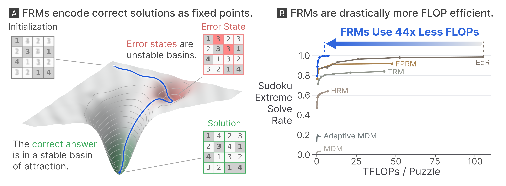

<h2 align="center">Flow Reasoning Models: Turning Flows Into Efficient Recurrent Reasoners</h2>

<p align="center">
  Alec Helbling · Andrey Bryutkin · Mauro Martino · Duen Horng (Polo) Chau · Nima Dehmamy · Hendrik Strobelt
</p>

<hr>

<p align="center">
  <a href="https://arxiv.org/abs/2606.29150"><strong>Paper</strong></a> ·
  <a href="https://huggingface.co/helblazer811/FlowReasoningModel"><strong>Models</strong></a>
</p>

<p align="center">
  
</p>

<p align="center">
  <em>FRMs shape correct solutions into stable attractors and reach EqR’s peak Sudoku-Extreme solve rate with 44× fewer inference FLOPs.</em>
</p>

<hr>

## Setup

Install from GitHub (Python 3.10+).

```bash
python -m venv .venv
source .venv/bin/activate
pip install "git+https://github.com/helblazer811/Flow-Reasoning-Models.git"
```

## Download models

Download a model with Hugging Face, or browse the files on
[Hugging Face](https://huggingface.co/helblazer811/FlowReasoningModel).

```python
from huggingface_hub import snapshot_download

snapshot_download(
    "helblazer811/FlowReasoningModel",
    allow_patterns=["sudoku/*"],
    local_dir="models",
)
```

Use `maze_unique/*` or `zebra/*` to download the other models. Each folder includes
the checkpoint, evaluation data, calibration, and training configuration.

## Evaluate

```bash
python -m frm.evaluate --model-dir models/sudoku
```

Replace `sudoku` with `maze_unique` or `zebra` as needed. Evaluation uses calibrated
sequential restarts and saves results under `outputs/`. Add `--max-samples 8` for a
quick check.

| Task | Test puzzles | Solve rate | Mean NFE |
|---|---:|---:|---:|
| Sudoku-Lite | 2,048 | 99.7070% | 899.75 |
| Maze-Unique | 1,000 | 99.9% | 15.708 |
| Zebra 5x5 | 1,024 | 99.6094% | 6.2402 |

Full seed results, evaluation settings, and benchmark scope are in the
[model card](https://huggingface.co/helblazer811/FlowReasoningModel). Reported NFE
measures the restart policy; evaluation also computes fixed-depth comparisons.

To evaluate the full Sudoku-Extreme test set, set `evaluation.num_samples: null`
in `models/sudoku/training.yaml`, then run the fixed-depth evaluation:

```bash
python -m frm.evaluate --sampler fixed_depth --config models/sudoku/training.yaml \
  --checkpoint models/sudoku/model.pt --output outputs/sudoku_extreme.json
```

Sudoku-Lite with sequential restarts remains the default above. The full-set
fixed-depth score is not reported here.

## Train

```bash
python -m frm.train --config models/sudoku/training.yaml
python -m frm.train --config models/maze_unique/training.yaml
python -m frm.train --config models/zebra/training.yaml
```

## Cite

```bibtex
@misc{helbling2026flowreasoningmodelsturning,
      title={Flow Reasoning Models: Turning Flows Into Efficient Recurrent Reasoners},
      author={Alec Helbling and Andrey Bryutkin and Mauro Martino and Duen Horng Chau and Nima Dehmamy and Hendrik Strobelt},
      year={2026},
      eprint={2606.29150},
      archivePrefix={arXiv},
      primaryClass={cs.AI},
      url={https://arxiv.org/abs/2606.29150},
}
```
